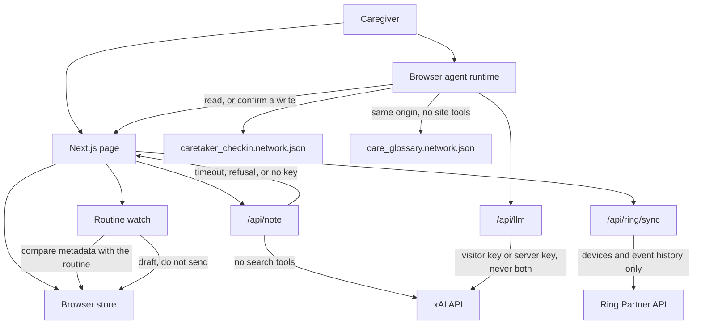

# Architecture

Caretaker Check-in is a Next.js app. The household state lives in the browser. The server is a thin, timed proxy for two read-only upstreams: the Ring Partner API and the xAI API. The agent graph is public JSON and runs in the page.

## Routine watch

`compareBaseline` places today's door and motion events into wake, morning check, door, lunch, dinner, evening, and settle. Only a missed morning check creates a draft. Other misses are sentences in the note. The draft is stored with `sent: false`. There is no function that sends it.

Simulated days are generated in `src/lib/simulate.ts` and labeled on the page. A Ring sync replaces them only after a successful metadata read. An expired token keeps the last sync if there is one, and otherwise shows the simulation with a plain explanation.

## Note

`/api/note` calls `POST /v1/responses` on `https://api.x.ai/v1` with `XAI_MODEL` (default `grok-4.7`). The body has no `tools` field. If that route answers 400, 404, 405, or 501, the server tries chat completions once. The verifier scans the text for diagnoses and emergency claims. A failed or missing model reply becomes `fallbackNote`, which uses the comparison sentences and the same event ids.

Care payloads omit the Ring token and device ids. They are not sent to web search or X search, because those tools are never attached.

## Ring

The sync route calls only:

- `GET /v1/devices`
- `GET /v1/history/devices/{id}/events?event_types=ding,motion`

`assertMetadataPath` throws on media, snapshot, and stream URLs. Live-view events (`on_demand`) are dropped. History is metadata: type and time. The device name supplies the door or kitchen role, and the caregiver can correct it.

Timeouts are 8 seconds with two retries for 408, 429, and 5xx. HTTP 401 is not retried. It is shown as an expired Playground token. See [RING_SETUP.md](RING_SETUP.md).

## Agent network

The manifest names `care_companion` as the front agent. It may call `routine_reader`, `checkin_drafter`, and the glossary link. Local agents receive `website_get_care_state`, `website_draft_check_in`, and `website_update_baseline`. Writes open a confirmation dialog. A peer network does not receive those tools, the visitor key, or credential fields.

Grounded mode is the same runtime with a deterministic completer, so the demo still delegates and calls tools when no model key is present. If a model call fails, the turn is tried again in grounded mode and the page says so.

Limits: depth 4, 8 invocations, 4 model rounds, 20 seconds, and 2 peer loads. An invalid network never calls the model.

## Self-healing

| Failure | What the page does |
| --- | --- |
| No `XAI_API_KEY` | Template note. Companion stays in grounded mode. |
| Grok timeout or bad JSON | Template note, and the health row says why. |
| Model text names a diagnosis or an emergency | Text is discarded. Template is shown. The reason is kept. |
| Ring 401 or 403 | Expired-token copy. Last metadata, or the labeled simulation. |
| Ring timeout or 5xx | Retry, then the same fallback. |
| Peer origin not approved | Tool error. The turn continues. |
| Write not confirmed | Handler does not run. |

The Health page polls `/api/health`. That check calls Ring without a token. A 401 from Ring means the host is reachable.
